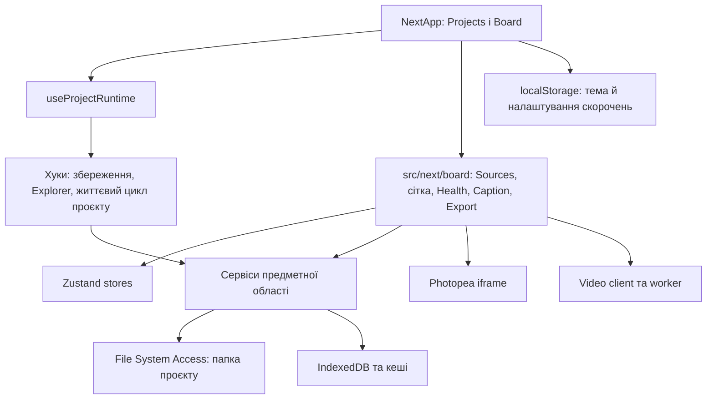

# Архітектура DatasetCreator

Статичний React-застосунок виконує обробку даних у браузері. Vite збирає ресурси для розміщення під `/DatasetCreator/`. Власного API-сервера або серверної бази даних у репозиторії немає.

## Межі модулів

- [`src/next/NextApp.tsx`](src/next/NextApp.tsx) — корінь єдиного інтерфейсу: вибирає між екраном Projects (`src/next/screens/ProjectsScreen.tsx`) і Board (`src/next/screens/BoardScreen.tsx`, змонтований із `key={projectId}`), монтує діалоги настроювання проєкту, Activity і Settings, а також оболонку `AppShell`. Кореневий стан дає [`src/next/useProjectRuntime.ts`](src/next/useProjectRuntime.ts): збереження, вигляд, Explorer (`src/hooks/useExplorerTree.ts`), його мутації через `runExplorerMutation` (`src/hooks/useExplorerMutations.ts`), життєвий цикл проєкту (`src/hooks/useProjectLifecycle.ts`) і список недавніх проєктів. Глобальні команди реєструє `src/next/useNextCommands.ts`. Вкладок, докування й Inspector немає: Explorer-хуки лишилися лише як власники файлових операцій, які викликає Board.
- `src/next/board/` — частини Board: Sources (`SourcesPanel.tsx`), сітка кадрів і lightbox, Assemble (`AssembleControls.tsx`, `useBoardPipeline.ts`), Health, Caption mode, діалоги Export, Project settings, Versions, Settings і Activity, оверлеї Photopea та Video Frames. Бізнес-правила (статус кадра, членство, добір) лишаються в сервісах і хуках `src/components/build/`, а не в цих компонентах.
- `src/components/workspace/` містить оболонку `AppShell`, рядок статусу, сповіщення, командну палітру й спільні діалоги моделей та Settings; `src/components/build/` — хуки Assemble, членства та кластерів без власного UI; `src/components/tools/` — лише `CleanupTool` (Photopea) і `VideoFramesTool`, які Board відкриває оверлеями.
- `src/lib/` містить проєкції ресурсів, правила шляхів і папок inbox, мітки статусів, команди та спільні дії.
- `src/services/` відповідає за імпорт, файли проєкту, Dataset, підписи, експорт, зображення, відео й моделі.
- `src/hooks/` з’єднує життєвий цикл React зі збереженням, операціями та документами Photopea.

Повна таблиця точок входу — у [карті коду](docs/code-map.md).

## Стан

| Store | Відповідальність |
| --- | --- |
| `useProjectStore` | `ProjectState`, вихідні та редаговані ресурси, Dataset, налаштування підписів |
| `useUIStore` | UI, вибір, фільтри, доступ до папки проєкту |
| `useDocumentStateStore` | Стан відкритих документів, незбережені зміни, запис і перевірка перед закриттям |
| `useOperationStore` | Прогрес, скасування й завершення тривалих операцій |
| `useHistoryStore` | Асинхронні Undo/Redo, до 20 записів, ізоляція за ID проєкту; Undo/Redo чекають завершення запущених history-транзакцій |
| `useLocalTaggerStore` | Сесія, стан і назви збережених файлів локального тегера |

Versioned `BuildSession` (версія 2) є частиною `ProjectState`, а не окремим глобальним store. Єдиний статус кадра виводить `getImageStatus` у `services/build/buildSessionService.ts`: користувач задає лише `override` (Pin або Ban), решту визначають фізичний шлях, тріаж і результат Assemble. Pure transitions, revision stamps і міграція v1 → v2 також належать цьому сервісу. Членство в Dataset застосовує `components/build/useApplyMembership.ts` (одна history-транзакція на дію), а `components/build/useBuildModel.ts` зводить елементи, кандидатів і сесію та єдиний пише reconcile у проєкт; React-компоненти лише оркеструють наявні caption, Dataset, transform, video та export owners.

`SourceImage` і `EditedAsset` зберігаються в словниках стану. `WorkspaceImage` — спільне представлення для галерей та інструментів, яке також охоплює файли з папки. Не створюйте окремі списки «тих самих зображень» у кожному інструменті: використовуйте проєкції `workspaceImages.ts` і кеш `workspaceFileAssets.ts`.

## Збереження та файлові операції

`useProjectSave` підключає `createSaveSession` до stores. Сесія прив’язана до конкретного проєкту та handle папки; без папки статус — `local`. Поточна затримка автозбереження в `saveSession.ts` — 250 мс.

`createSaveQueue` послідовно записує snapshots. Базовий збережений стан оновлюється тільки після успішного запису. Під час запису нові зміни накопичуються й записуються наступними; помилка залишає можливість повтору. `runProjectFileOperation` проводить файлові зміни через ту саму чергу. Усередині exclusive-операції не можна викликати `flush`: це може заблокувати чергу.

Зміна проєкту від’єднує попередню сесію. Завершення її старого запиту не повинно змінювати статус нового проєкту. Зміни шляхів синхронізуються з посиланнями у store, Explorer, файловим кешем і вкладками. Часткові помилки мають зберігати відомості про вже завершені операції.

## Dataset, підписи й експорт

Dataset — фізична папка `dataset/` (лише пари image + TXT, підпапки дозволені), а не список активних ID. `datasetMembershipResolver.ts` визначає членство за шляхом. `datasetFolderService.ts` переміщує файли, а `assetActions.ts` додає інтеграцію з історією. Видалення з Dataset переміщує ресурс у `inbox/`. Службові дані проєкту лежать у `.datasetcreator/` (`project.json`, реєстр `assets.json`, cache, versions, journal, backup); `.git` не використовується, справжній Git-репозиторій захищено. Формат теки, відкриття (reconcile з реєстром, rebind за SHA-256) і міграція описані в [моделі даних](docs/data-model.md).

Підпис ресурсу — файл `<stem>.txt` поруч із зображенням; формат (trigger word першим лише в `dataset/`) належить `captionFileService.ts`. `resolveAssetCaption` розрізняє відсутній TXT (tags відсутні) і порожній (`[]`): порожній підпис не слід підміняти fallback-текстом. Зміна trigger word — пакетний перезапис TXT з Undo (`rewriteTriggerWord`, застосовується на Enter/blur). Старі sidecar-теги й Dataset overrides читаються лише міграцією.

`buildExportPlan` у `exportPlan.ts` — єдиний власник експорту: план імен, blob-даних і фінальних підписів. Експорт Dataset — побайтова копія `dataset/` з підпапками (TXT як на диску), ZIP за замовчуванням зберігається в `exports/` (`saveZipToProjectExports`). ZIP і запис у папку використовують цей план. Перед записом у папку перевіряються конфлікти вихідних імен. Підтримка PSD делегує конвертацію Photopea, а не змінює лише розширення файлу.

План має content fingerprint. Під час folder export UI веде журнал повністю записаних image+TXT пар; retry перевіряє їх у вибраній папці, пропускає лише підтверджені пари й не перезаписує конфлікти.

## Аналіз і зовнішні інтеграції

Не всі вектори в проєкті мають однаковий зміст:

- `image/embeddingService.ts` обчислює гістограмні ознаки для наявного аналізу схожості.
- `video/videoModel.ts` завантажує й виконує DINOv2 через ONNX Runtime Web.
- `similarity/similarityLevels.ts` — єдина таблиця рівнів схожості DINOv2 (duplicate / near-copy / similar / related) і стопів Strictness; гістограмні пороги лише запасні. Поріг near-copy спільний для автодобору, тріажу Assemble і звіту якості.
- `quality/imageQuality.ts` вимірює технічну якість кожного зображення (роздільність, різкість, експозиція) для тріажу Assemble (`build/buildTriageService.ts`, `components/build/useBuildAutoPipeline.ts`: тріаж, добір і запис результату виконує Assemble, а підписи описує Auto-caption; обидва запускаються лише явною дією користувача; пул кандидатів визначає `selectAssemblyCandidates`; Pin і Ban переважають).
- `quality/metrics/` будує звіт якості Dataset: обов’язкові перевірки визначають готовність як найгірший статус, пояснювальні метрики (Vendi, покриття, профільні осі покриття, насичення, теги з політикою за типом проєкту, довжина підписів, узгодженість) не дають загального балу. Пороги зібрано в `thresholds.ts`; для DINOv2 вони евристичні й не відкалібровані, а звіт описує файли, а не якість навченої моделі.
- `analysis/semanticFeatureService.ts` використовує DINOv2 для зображень і локальне хешування Unicode-токенів та біграм для тексту. Це не мовна модель. Зображення кодує лінивий воркер (`semanticWorkerClient.ts`, `semanticWorker.worker.ts`), який сам читає байти моделі з IndexedDB; вектори кешуються в пам’яті (LRU) і постійно в `semanticFeatureStore.ts` (`dataset-creator-embeddings-v1`). Модель не завантажується мовчки (за відсутності моделі Assemble питає користувача через `isModelDownloadRequired`, а Health показує запит на завантаження), а `SemanticModelError` зупиняє весь запуск. Хеш збереженої моделі перевіряється раз на сесію сторінки: перезапущений воркер отримує прапорець `verified`. DINOv2 запитується лише при промаху кешу векторів.
- Тегер WD виконується в окремому лінивому воркері (`tagging/taggerWorkerClient.ts`, `taggerWorker.worker.ts`); `localTaggerRelease.ts` звільняє воркер і сесію. Якщо воркери доступні, `connectLocalTaggerBundle` не створює ONNX-сесію в головному потоці: модель завантажується й перевіряється в воркері (`validateModelInTaggerWorker`, у головний потік повертається лише `TaggerModelInfo`), а пакет тримає `modelFile` і `workerKey`. При збої WebGPU воркер повідомляє про нього й відкочується на WASM; відновлення при запуску викликає з `keepWorkerWarm: false`, щоб повернути пам’ять. Без воркерів сесія живе в головному потоці. `AppErrorBoundary` у `main.tsx` перехоплює необроблені помилки рендеру.
- `dataset/shortlistService.ts` — два проходи Assemble над спільним `datasetAssemblyService`: шорт-лист (~1,75× потрібної кількості, квоти кластерів k-medoids, поріг із Strictness проєкту; у режимі Auto — один представник на групу схожості) і звуження за IDF-покриттям тегів та візуальним приростом (лише для Target). Проходи самі не рухають файли: `useBuildAutoPipeline` записує результат кожного кадра в його запис сесії (`assembly`), а додавання в Dataset — один пакет переміщень і один Undo через `useApplyMembership`.
- Імпорт декодує зображення воркером `imageWorker` (`probe`: розмір, мініатюра, гістограма, хеш), а `createImportBatcher` групує додавання й збереження пакетами; переміщення в Dataset оновлюють шляхи й реєстр один раз на пакет.
- `dataset/coverageService.ts` і `datasetAssemblyService.ts` оцінюють покриття заданої множини; ці оцінки не доводять якість навчання моделі.

Відео має окремий client/worker, кеш кадрів і обмеження паралельних операцій. Photopea — зовнішній iframe із протоколом повідомлень і чергою PSD-прев’ю. Тегер використовує вибрані користувачем ONNX/CSV-файли. Наявність типів crop/augmentation не означає наявності окремих інструментів або workers для них. Transform проєкту (None, Fit 512, Center crop 512/768) застосовує `buildTransformService.ts` під час прийняття кадра в Dataset.

Старі проєкти (v2/v1) оновлює `layoutMigrationService.ts` із журналом, знімком і бекапами; діалог — `ProjectUpgradeDialog`. Формат файлів і міграції описані в [моделі даних](docs/data-model.md), перевірки — у [посібнику розробника](docs/development.md).

## Екрани Board

Усі основні дії доступні на самому Board: режими Select і Caption, Assemble, Pin і Ban, Health, Export. Статус кадра береться з `getImageStatus` через `lib/imageStatusLabels.ts` (текст, підказка, фільтри) і не зберігається окремо. Галереї тримаються на `workspaceImages`/`workspaceFileAssets`, підписи — на caption mutation service, експорт — на плані експорту. Health показує звіт якості Dataset (`useDatasetQualityReport`), а фільтр за кліком діє лише в стані екрана й не зберігається. Статус готовності береться зі звіту, а не з наявності підпису.

Старі ключі localStorage (режим інтерфейсу, layout, докування, щільність, вкладка, `review-view:*` і прив’язки скорочень) один раз очищає `src/lib/legacyStorageCleanup.ts` при запуску з `src/main.tsx`; лишаються тема й параметри скорочень (`singles`). Параметри адреси `?ui=` і `?tool=` ігноруються.

## Написання підписів і локальне тегування

Lightbox у режимі Caption використовує `src/components/caption/CaptionEditor.tsx`: керований текст, автодоповнення поточного фрагмента, клавіатурний вибір і попередження про повтори. Словник може поєднувати теги проєкту, підключеної моделі та імпортований користувачем список. Редактор не записує файли самостійно; чинні власники екранів викликають caption mutation service.

`src/services/tagging/localTaggerFileSettings.ts` зберігає вибрані ONNX і CSV у браузерному IndexedDB: native file handles, а для звичайного file input — копії `File`. Їхні назви й доступ належать браузеру, а не поточному проєкту чи його налаштуванням підписів. `localTaggerConnectionService.ts` спільно керує підключенням із Caption mode і Settings та відкидає результат застарілого підключення. Під час запуску застосунок одноразово пробує відновити пару файлів без запиту дозволу; якщо браузер відкликав доступ до handle, користувач може повторити спробу з дозволом через Reconnect/Restore saved model. Копії `File` читаються без запиту дозволу.

Модель WD ViT Tagger v3 (`SmilingWolf/wd-vit-tagger-v3`, Apache-2.0, закріплена revision, ≈378.8 MB) завантажується лише явною дією користувача у Settings або із запиту підключення в Caption mode (`WdTaggerDownloadPanel`). Маніфест із розмірами й SHA-256 — `wdTaggerModelManifest.ts`; процес, прогрес, скасування й повтор — `wdTaggerDownloadService.ts`; стан — `useLocalTaggerStore`. Перевірене завантаження виконує спільний `src/services/models/verifiedModelDownload.ts` (його ж використовує DINOv2 у `video/videoModel.ts`). Файли зберігаються як копії `File` у тому самому IndexedDB-сховищі тегера з позначкою `source: 'download'` і SHA-256; цей запис без провенансу перезаписує ручний вибір файлів. Під час кожного відновлення збережені завантажені файли перевіряються за SHA-256 повторно. Скасування або помилка нічого не зберігають; після успіху тегер підключається автоматично, і Auto-caption працює далі. Завантаження ніколи не стартує саме.

`src/services/tagging/wdTagger.ts` зберігає індекси та категорії рядків selected_tags.csv. Для WD bundle з колонкою category застосовується BGR float32 у діапазоні 0–255; старий формат CSV лише з name зберігає попередню RGB-поведінку. Рейтинги за замовчуванням виключені з підписів, поріг персонажів — не нижчий за 0.85 і загальний поріг. Наявність ONNX-файла не гарантує сумісність довільної моделі. Browser Canvas resize не гарантує піксельної тотожності Pillow bicubic з еталонної реалізації.
