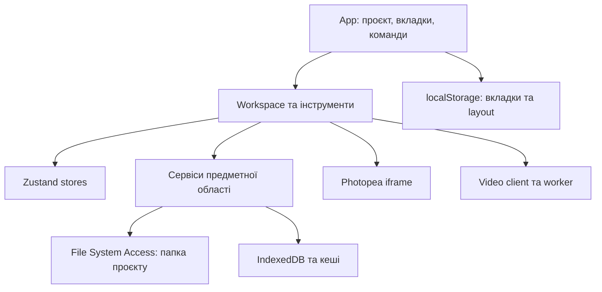

# Архітектура DatasetCreator

Статичний React-застосунок виконує обробку даних у браузері. Vite збирає ресурси для розміщення під `/DatasetCreator/`. Власного API-сервера або серверної бази даних у репозиторії немає.

## Межі модулів

- [`src/App.tsx`](src/App.tsx) координує відкриття проєкту, файлові операції Explorer, вкладки, команди й підключення панелей. Це великий інтеграційний модуль; нову незалежну логіку краще розміщувати в наявних сервісах.
- `src/components/workspace/` містить оболонку, докування, Explorer, Dataset, меню, статус операцій і командну палітру.
- `src/components/build/` містить єдиний Build Dataset workspace, а `src/components/tools/` — окремі Import, Video Frames, Remove Duplicates, Photopea, Analysis, Review, Caption та Export. Список і назви визначає [`toolDefinitions.ts`](src/lib/toolDefinitions.ts).
- `src/lib/` містить проєкції ресурсів, правила вкладок і шляхів, геометрію, команди та спільні дії.
- `src/services/` відповідає за імпорт, файли проєкту, Dataset, підписи, експорт, зображення, відео й моделі.
- `src/hooks/` з’єднує життєвий цикл React зі збереженням, навігацією, операціями та документами Photopea.

Повна таблиця точок входу — у [карті коду](docs/code-map.md).

## Стан

| Store | Відповідальність |
| --- | --- |
| `useProjectStore` | `ProjectState`, вихідні та редаговані ресурси, Dataset, налаштування підписів |
| `useUIStore` | UI, вибір, фільтри, доступ до папки проєкту |
| `useDocumentStateStore` | Стан відкритих документів, незбережені зміни, запис і перевірка перед закриттям |
| `useOperationStore` | Прогрес, скасування й завершення тривалих операцій |
| `useHistoryStore` | Асинхронні Undo/Redo, до 20 записів, ізоляція за ID проєкту |
| `useLocalTaggerStore` | Сесія та стан локального тегера |

Versioned `BuildSession` є частиною `ProjectState`, а не окремим глобальним store. Pure transitions, стабільна черга, revision stamps і readiness належать `services/build/buildSessionService.ts`; React-компонент лише оркеструє наявні caption, Dataset, transform, video та export owners.

`SourceImage` і `EditedAsset` зберігаються в словниках стану. `WorkspaceImage` — спільне представлення для галерей та інструментів, яке також охоплює файли з папки. Не створюйте окремі списки «тих самих зображень» у кожному інструменті: використовуйте проєкції `workspaceImages.ts` і кеш `workspaceFileAssets.ts`.

## Збереження та файлові операції

`useProjectSave` підключає `createSaveSession` до stores. Сесія прив’язана до конкретного проєкту та handle папки; без папки статус — `local`. Поточна затримка автозбереження в `saveSession.ts` — 250 мс.

`createSaveQueue` послідовно записує snapshots. Базовий збережений стан оновлюється тільки після успішного запису. Під час запису нові зміни накопичуються й записуються наступними; помилка залишає можливість повтору. `runProjectFileOperation` проводить файлові зміни через ту саму чергу. Усередині exclusive-операції не можна викликати `flush`: це може заблокувати чергу.

Зміна проєкту від’єднує попередню сесію. Завершення її старого запиту не повинно змінювати статус нового проєкту. Зміни шляхів синхронізуються з посиланнями у store, Explorer, файловим кешем і вкладками. Часткові помилки мають зберігати відомості про вже завершені операції.

## Dataset, підписи й експорт

Dataset — фізична папка `dataset/`, а не список активних ID. `datasetMembershipResolver.ts` визначає членство за шляхом. `datasetFolderService.ts` переміщує файли, а `assetActions.ts` додає інтеграцію з історією. Видалення з Dataset переміщує ресурс у `src/shared/`.

Підписи належать ресурсам. `resolveAssetCaption` розрізняє відсутні tags і явно порожній масив: порожній підпис не слід підміняти fallback-текстом. Старі Dataset overrides читаються лише для сумісності й міграції.

`buildExportPlan` створює план імен, blob-даних і фінальних підписів. ZIP і запис у папку використовують цей план. Перед записом у папку перевіряються конфлікти вихідних імен. Підтримка PSD делегує конвертацію Photopea, а не змінює лише розширення файлу.

План має content fingerprint. Під час folder export UI веде журнал повністю записаних image+TXT пар; retry перевіряє їх у вибраній папці, пропускає лише підтверджені пари й не перезаписує конфлікти.

## Аналіз і зовнішні інтеграції

Не всі вектори в проєкті мають однаковий зміст:

- `image/embeddingService.ts` обчислює гістограмні ознаки для наявного аналізу схожості.
- `video/videoModel.ts` завантажує й виконує DINOv2 через ONNX Runtime Web.
- `analysis/semanticFeatureService.ts` використовує DINOv2 для зображень і локальне хешування Unicode-токенів та біграм для тексту. Це не мовна модель.
- `dataset/coverageService.ts` і `datasetAssemblyService.ts` оцінюють покриття заданої множини та пропонують доповнення; ці оцінки не доводять якість навчання моделі.

Відео має окремий client/worker, кеш кадрів і обмеження паралельних операцій. Photopea — зовнішній iframe із протоколом повідомлень і чергою PSD-прев’ю. Тегер використовує вибрані користувачем ONNX/CSV-файли. Наявність типів crop/augmentation не означає наявності окремих інструментів або workers для них.

Формат файлів і міграції описані в [моделі даних](docs/data-model.md), перевірки — у [посібнику розробника](docs/development.md).

## Інспектор і робочі екрани

Основні дії Build, Analysis, Caption і Photopea доступні всередині відповідного екрана незалежно від відкриття Inspector. Налаштування Dataset належать його екрану та профілю Build. Inspector показує поточне виділення, фізичне членство в Dataset, підпис і додаткові властивості; він не є другим редактором підписів.

`src/stores/useInspectorSelectionStore.ts` передає тимчасовий контекст активної вкладки з Build, Analysis, Caption і галерей Review/Dataset. Контекст прив’язаний до власника-вкладки, очищується при зміні проєкту та не зберігається в manifest. `src/components/workspace/InspectorSelectionDetails.tsx` відображає цей контекст. Статус готовності Build надходить із його чинного сервісу; наявність підпису в інших режимах не означає готовність до експорту.

## Написання підписів і локальне тегування

Build і Caption використовують спільний `src/components/caption/CaptionEditor.tsx`: керований текст, автодоповнення поточного фрагмента, клавіатурний вибір і попередження про повтори. Словник може поєднувати теги проєкту, підключеної моделі та імпортований користувачем список. Редактор не записує файли самостійно; чинні власники екранів викликають caption mutation service.

`src/services/tagging/wdTagger.ts` зберігає індекси та категорії рядків selected_tags.csv. Для WD bundle з колонкою category застосовується BGR float32 у діапазоні 0–255; старий формат CSV лише з name зберігає попередню RGB-поведінку. Рейтинги за замовчуванням виключені з підписів, поріг персонажів — не нижчий за 0.85 і загальний поріг. Наявність ONNX-файла не гарантує сумісність довільної моделі. Browser Canvas resize не гарантує піксельної тотожності Pillow bicubic з еталонної реалізації.
