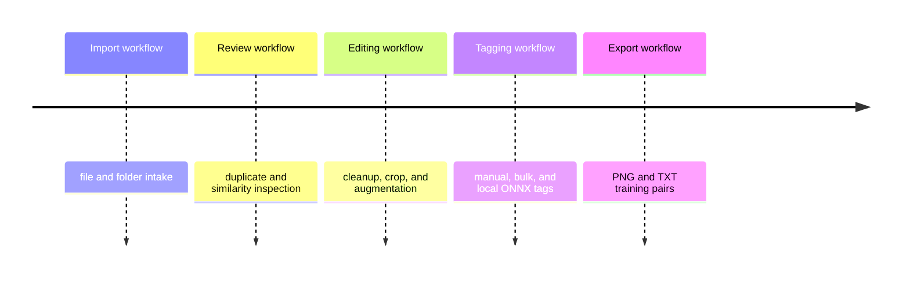

<h1 align="center"> 🍍 DatasetCreator 🍍 </h1>

<p align="center">
  
  
  
</p>
<p align="center">
  
  
  
  
  
  
  
</p>

DatasetCreator is a local-first web app for preparing image datasets for Stable Diffusion training. It guides images through import, duplicate review, cleanup, cropping, augmentation, tagging, and export into ready-to-train PNG and TXT pairs.

## Overview

The project is built around an eight-stage dataset workflow that keeps image processing in the browser. Users can import image files or folders, inspect similarity groups, clean and crop source images, generate augmentation variants, review the final set, add manual or local ONNX tags, and export a complete training dataset without a required backend.

DatasetCreator uses React 18, TypeScript, Vite, Tailwind CSS, Zustand, JSZip, Lucide React, and ONNX Runtime Web. Project state is browser-first, with IndexedDB-backed persistence where supported and local object URLs for previews.

## Features

- Image and folder import for building a dataset from local files.
- Similarity review for finding duplicate or near-duplicate images.
- Browser-based cleanup tools with brush, erase, zoom, undo, and redo support.
- Multi-aspect crop workflow with aspect ratio locks.
- Dataset augmentation with flips, color variants, and rotations.
- Final review stage for inspecting generated dataset relationships.
- Manual and bulk tag editing before export.
- Local Danbooru-style ONNX auto-tagging from a user-selected model folder.
- Training-ready export as matching PNG and TXT file pairs.
- Local-first workflow with no required backend for the main pipeline.
- Static build suitable for GitHub Pages and other static hosts.

## Screenshots

Screenshots can be added here when repository assets are available.

```text
docs/screenshots/import.png
docs/screenshots/tagging.png
```

## Installation

1. Install the required tooling:
   - Node.js 16 or newer;
   - npm;
   - a modern desktop browser.

2. Clone the repository:

```bash
git clone https://github.com/TimCixo/DatasetCreator.git
cd DatasetCreator
```

3. Install dependencies:

```bash
npm install
```

4. Build the project when preparing a production bundle:

```bash
npm run build
```

## Usage

Run the Vite development server:

```bash
npm run dev
```

Open the local Vite URL in a browser, usually:

```text
http://localhost:5173
```

Use the stages in order:

1. Import images from files or folders.
2. Review duplicate and similarity groups.
3. Clean images with browser-based editing tools.
4. Create training crops with the required aspect ratios.
5. Generate augmentation variants.
6. Inspect the final dataset.
7. Add manual, bulk, or local ONNX-generated tags.
8. Export PNG images with matching TXT prompts.

For the local auto-tagger, select a folder that contains:

```text
model.onnx
selected_tags.csv
```

Compatible tagger models include `wd-vit-tagger-v3`, `wd-convnext-tagger-v3`, `wd-swinv2-tagger-v3`, and `wd-vit-large-tagger-v3` from SmilingWolf on Hugging Face. Model access is session-based in the browser, so reconnecting the folder may be required after a reload.

Preview a production build locally:

```bash
npm run preview
```

## Project Structure


## Configuration

DatasetCreator is a static client-side application. The main workflow does not require a backend or server-side configuration.

The Vite configuration lives in `vite.config.ts`. Styling is configured through `tailwind.config.ts`, `postcss.config.js`, `src/index.css`, and `src/App.css`. UI component metadata is kept in `components.json`.

Browser storage is handled by the persistence service under `src/services/persistence`. Image files and model files are selected by the user through browser file APIs. For reliable local folder access and model loading, use `localhost` during development or HTTPS in hosted environments.

The local auto-tagger expects a user-selected folder containing `model.onnx` and `selected_tags.csv`. WebGPU is used when available, with ONNX Runtime WebAssembly as a fallback.

## Development

- Runtime: static browser application served by Vite.
- Frontend: React 18 with TypeScript.
- Styling: Tailwind CSS 3 with local CSS layers.
- State: Zustand stores for project, UI, and local tagger state.
- Image workflow: dedicated services for cleanup, similarity, cropping, augmentation, and export.
- Persistence: IndexedDB-backed browser storage where supported.
- Tagging: ONNX Runtime Web for local model inference.

Recommended development flow:

1. Start the Vite dev server.
2. Work on one pipeline stage at a time under `src/components/stages`.
3. Keep image-processing behavior inside the relevant service folder.
4. Keep shared project state changes in the Zustand stores.
5. Run linting and a production build before publishing.

Useful commands:

```bash
npm run dev
npm run lint
npm run build
npm run preview
```

## Roadmap



## Development Board


## Contributing

Contributions are welcome.

You can help by:
- reporting bugs;
- suggesting dataset workflow improvements;
- improving documentation;
- testing with different image formats, dataset sizes, and browser environments;
- submitting pull requests.

Before making large changes, please open an issue first to discuss the idea.

## License

The previous project documentation identifies this project as MIT licensed.

Add a `LICENSE` file to the repository to make the license terms explicit for package registries, GitHub, and contributors.

## Credits

Created by [TimCixo](https://github.com/TimCixo).

Built for local-first Stable Diffusion dataset preparation workflows.
