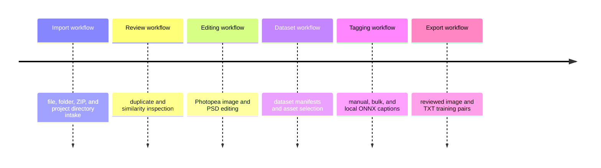

<h1 align="center"> 🍍 DatasetCreator 🍍 </h1>

<p align="center">
  
  
  
</p>
<p align="center">
  
  
  
  
  
  
  
</p>

DatasetCreator is a local-first web app for preparing image datasets for Stable Diffusion training. It provides a browser workspace for importing assets, reviewing duplicates and similarity, editing images with Photopea, captioning with manual or local ONNX tags, and exporting ready-to-train PNG and TXT pairs.

## Overview

The project is built around a shared image workspace instead of a required backend. Users can import files, folders, or ZIP archives; organize assets in an Explorer; open tools and files in tabs; create dataset manifests; review image, video, and PSD assets; caption the final set; and export training files from the browser.

DatasetCreator uses React 18, TypeScript, Vite, Tailwind CSS, Zustand, JSZip, Lucide React, Radix UI, Photopea integration, and ONNX Runtime Web. Project state is browser-first, with IndexedDB-backed persistence and File System Access API support where available.

## Features

- File, folder, drag-and-drop, and ZIP import for local project assets.
- Supported assets: BMP, GIF, JPEG/JPG, PNG, WebP, TXT, JSON, PSD, MP4, and WebM.
- Workspace shell with an Explorer/Versions activity bar, resizable docked groups, draggable tabs, and floating windows.
- Project directory support with `manifest.json`, cached previews, and auto-save.
- Dataset manifests stored as `*.dataset.json` files.
- Similarity review for finding duplicate or near-duplicate images.
- Analysis views for image relationships, pairs, clusters, and graph layout.
- Photopea-based editing for workspace images and PSD files.
- Review tool for image, video, and PSD assets with active/inactive export status.
- Manual and bulk caption editing before export.
- Local Danbooru-style ONNX auto-tagging from user-selected model files.
- Training-ready export as matching PNG and TXT file pairs.
- ZIP export plus direct directory export in browsers that support `showDirectoryPicker`.
- Static build suitable for GitHub Pages and other static hosts.

## Screenshots

Screenshots can be added here when repository assets are available.

```text
docs/screenshots/import.png
docs/screenshots/tagging.png
```

## Installation

1. Install the required tooling:
   - Node.js 20 is recommended;
   - npm;
   - a modern desktop browser.

2. Clone the repository:

```bash
git clone https://github.com/TimCixo/DatasetCreator.git
cd DatasetCreator
```

3. Install dependencies:

```bash
npm install
```

4. Build the project when preparing a production bundle:

```bash
npm run build
```

## Usage

Run the Vite development server:

```bash
npm run dev
```

Open the local Vite URL in a browser, usually:

```text
http://localhost:5173/DatasetCreator/
```

Use the workspace tools in order:

1. Import images and project assets from files, folders, or ZIP archives.
2. Review duplicate and similarity groups.
3. Edit images or PSD files through the Photopea tool.
4. Analyze image relationships when needed.
5. Review the final dataset assets.
6. Create or open `*.dataset.json` files and add assets to them.
7. Add manual, bulk, or local ONNX-generated captions.
8. Export PNG images with matching TXT prompts as a ZIP or into a directory.

For the local auto-tagger, select files or a folder that contains:

```text
model.onnx
selected_tags.csv
```

Compatible tagger models should use the WD/Danbooru-style `selected_tags.csv` format used by SmilingWolf tagger models. Model access is session-based unless the browser can persist file handles, so reconnecting the files may be required after a reload.

Preview a production build locally:

```bash
npm run preview
npm run test:ui-workflows
npm run test:project-types
npm run test:workspace-layout
npm run test:video-frames
```

### Workspace layout

- Explorer stays in the left sidebar. Other windows and editor tabs can be placed beside it or stacked with it.
- Drag a tab or a group's grip onto another group: the highlighted edge creates a split, and the center combines tabs. Press Escape to cancel.
- Drag a divider to resize neighboring groups. Layout, active tabs, pinned tabs, and floating-window geometry are saved locally.
- Use the header pin button to detach a group or return it to its previous docked position. Floating windows support resize, minimize, and close; hold Alt while dragging to move them without docking.
- The Windows menu opens Explorer, Inspector, Output, Project, and Dataset. These are the same windows whether docked or floating.
- A pinned tab stays on the left of its group and cannot be closed until unpinned, including through bulk-close actions.

Run layout and project regression checks with `npm run test:workspace-layout` and `npm run test:project-types`.

### Video Frames

Open **Tools → Video Frames**, choose an MP4/WebM file, or use **Video Frames** in a project video's context menu. Each video opens in a normal dockable editor. Files remain on your device; no video or frame is uploaded.

- **Manual:** play at 0.1×–2× speed, zoom, step through actual presentation timestamps (including variable frame rate), and loop an In/Out range. Pause to save the displayed frame as an original-resolution PNG. Rotation and pixel aspect ratio are respected.
- **Automatic:** explicitly download the DINOv2 model once, then choose **Fast** (2 frames/s by default, plus scene changes) or **Full** (every decoded frame). Fast can miss brief moments. Full, especially on CPU or 4K sources, may take much longer than playback.
- Selection uses normalized visual features and farthest-first cosine distance, not the older Analysis histogram. The defaults are at most 50 frames and a minimum distance of 0.15; fewer frames are returned when the remaining candidates are too similar. These distances are **not coverage percentages** and do not measure training quality.
- Review thumbnails, exclude frames, pin required frames, or replace a selected frame with a nearby one. **Recalculate selection** reuses cached features; a replacement only requires inference for that frame. Dark, blurry, and scene-transition warnings are heuristics, not authoritative quality judgments.
- Choose a visible project directory and **Save frame** or confirm **Save selected**. Existing names receive a unique suffix. Saving does not add files to the global Dataset; use the existing explicit Dataset actions separately. **Refresh folders** updates the destination list after creating folders in Explorer.
- Analysis runs in a worker with bounded batches and a separate IndexedDB cache for features and small thumbnails. Only selected full-resolution frames are decoded for export. Cache identity includes all source bytes, model hash, preprocessing, range, and sampling settings. **Clear video cache** removes model weights and cached analyses, never project files.
- Only one video operation runs at a time across editor tabs to bound model memory use. Switching tabs or docking does not cancel it; closing a busy tab asks for confirmation. Cancel stops new work; successfully saved files remain. Restarting analysis can reuse completed cache batches. Automatic job restoration after browser shutdown is not provided.

The pinned model is the [Xenova ONNX conversion of DINOv2-small](https://huggingface.co/Xenova/dinov2-small/tree/560a572cedd01ab59cf1a614c2d9673397b65ef2) (ViT-S/14, 384-dimensional CLS features, 88,459,888 bytes). SHA-256: `83141175ec78b4ff9a2bb58a4c7c264ba0054d1c2e122e5a8114b79a8d4179ea`. Downloads are verified before use. Preprocessing is RGB, shortest edge 256, center crop 224, Canvas high-quality resampling, ImageNet normalization, then L2 normalization. WebGPU is preferred with WASM fallback; there is no histogram substitute when the model fails. Model provenance and licensing are described in the [upstream DINOv2 repository](https://github.com/facebookresearch/dinov2).

Video support depends on the browser's WebCodecs decoders, not just the file extension. Recent Chromium with File System Access is recommended for directory saves. Unsupported codecs and storage errors are reported explicitly. HDR-to-SDR rendering follows browser canvas behavior; HDR-preserving export is not supported.

Run `npm run test:video-frames` for selection, frame-index, cancellation, fingerprint, and safe-write checks, including streaming selection over 108,000 feature vectors. With the development server running, open `/DatasetCreator/tests/video-browser.html` for generated VFR/rotated-video fixtures, one-hour streaming decoding, a real-model WASM/WebGPU comparison when a GPU adapter is available, Full/Fast/cache tests, and interactive save/docking checks. The harness writes PNGs to an in-memory test directory, not a real project. Real-model checks download the same pinned model on demand; they are not part of the offline test command.

## Project Structure


## Configuration

DatasetCreator is a static client-side application. The main workflow does not require a backend or server-side configuration.

The Vite configuration lives in `vite.config.ts`. The current base path is:

```ts
base: '/DatasetCreator/'
```

Styling is configured through `tailwind.config.ts`, `postcss.config.js`, `src/index.css`, and `src/components/workspace/workspace.css`. UI component metadata is kept in `components.json`.

Browser storage is handled by the persistence service under `src/services/persistence`. Project directory reads and writes use the File System Access API where supported. For reliable local folder access and model loading, use `localhost` during development or HTTPS in hosted environments.

Project directories are stored with a `manifest.json`, app-managed cache data, imported assets, and optional `*.dataset.json` files. Export shows the exact image filenames and final captions before writing matching image/TXT pairs. Raster images keep their original formats; linked PSD files convert to PNG through Photopea. Choose Dataset selection, all workspace images, or images in the physical `dataset/` folder, then ZIP or a destination folder. Folder export refuses existing output filenames.

The local auto-tagger expects `model.onnx` and `selected_tags.csv`. ONNX Runtime Web is used for local inference.

## Workspace controls

Use **Ctrl/Cmd + K** to find tools, focus a panel, manage tabs, save, or undo. **?** opens shortcut settings, including remapping and the option to turn off single-key shortcuts. Text inputs retain their normal typing and undo behavior; Photopea has its own shortcuts inside its editor.

**Ctrl/Cmd + S** saves the active Photopea document; outside document editors it saves the project. Save and Save copy are available in the editor as well as Inspector, and remain disabled while that document is loading or being written. Inside Photopea, **Ctrl/Cmd + O** (File → Open) returns focus to Explorer to choose another file; it also provides a keyboard route out of the iframe.

In Dataset, Review and Caption, use **/** to search filenames or tags, arrows to move between files, **Space** to select, **Shift + arrows** for a range, and **Ctrl/Cmd + A** for all filtered files. **D** adds the selection to Dataset in Review or Caption; **E** includes or excludes it from export. **Enter** opens the preview and **Escape** closes it. **Ctrl/Cmd + Enter** saves a caption and focuses the next image. Commands affect the focused panel.

Batch captions apply to the gallery selection, or to the filtered files when nothing is selected. Dataset has a separate **Remove from Dataset** action that preserves original files. Undo/Redo covers membership, export inclusion and caption changes.

The footer shows whether the workspace is temporary, saved, saving, or needs another save attempt. **Operations** keeps import, export, caption, video and document-write progress visible across tabs, with cancellation where supported and a link back to the tool. Document writes finish before their tab can be closed or the project switched. Cancelling import or folder export preserves files already completed. Theme (System/Light/Dark), density, filters and layout can be adjusted without explanatory banners occupying the work area.

## Development

- Runtime: static browser application served by Vite.
- Frontend: React 18 with TypeScript.
- Styling: Tailwind CSS 3 with local CSS layers.
- State: Zustand stores for project, UI, and local tagger state.
- Image workflow: dedicated services for import, similarity, editing, review, tagging, project files, and export.
- Persistence: IndexedDB-backed browser storage and project-directory snapshots where supported.
- Tagging: ONNX Runtime Web for local model inference.

Recommended development flow:

1. Start the Vite dev server.
2. Work on one workspace tool at a time under `src/components/tools`.
3. Keep browser-processing behavior inside the relevant service folder.
4. Keep shared project state changes in the Zustand stores.
5. Run a production build before publishing.

Useful commands:

```bash
npm run dev
npm run build
npm run preview
npm run test:ui-workflows
npm run test:project-types
npm run test:workspace-layout
npm run test:video-frames
```

`package.json` also defines `npm run lint`, but the repository currently has no ESLint configuration, so linting is not an active validation gate yet.

## Roadmap



## Development Board


## Contributing

Contributions are welcome.

You can help by:
- reporting bugs;
- suggesting dataset workflow improvements;
- improving documentation;
- testing with different image formats, dataset sizes, and browser environments;
- submitting pull requests.

Before making large changes, please open an issue first to discuss the idea.

## License

MIT. See [LICENSE](LICENSE).

## Credits

Created by [TimCixo](https://github.com/TimCixo).

Built for local-first Stable Diffusion dataset preparation workflows.
